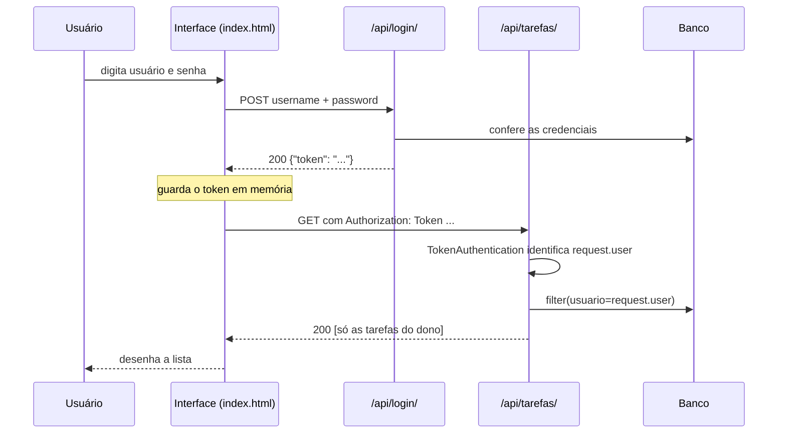

<!--
  LISTA DE PRINTS — salve cada imagem em docs/prints/ com exatamente estes nomes:

  01-foguete.png              Página inicial do Django (Passo 1)
  04-migrations.png           Terminal com "Create model Tarefa" (Passo 4)
  04-admin-usuarios.png       Admin com os usuários ana e beto (Passo 4)
  04-admin-tarefas.png        Admin com a lista de tarefas (Passo 4)
  07-rotas.png                Página 404 na raiz listando as rotas (Passo 7)
  09-01-login.png             Insomnia/Postman: POST /api/login/ → 200 (token borrado!)
  09-02-sem-token-401.png     GET /api/tarefas/ sem token → 401
  09-03-criar-tarefa.png      POST /api/tarefas/ → 201
  09-04-usuario-ignorado.png  POST com "usuario" do beto → dono continua a ana
  09-05-filtro-prioridade.png GET ?prioridade=Alta
  09-06-filtro-pendentes.png  GET ?concluida=false
  09-07-patch.png             PATCH {"concluida": true} → 200
  09-08-isolamento-404.png    Beto acessando tarefa da ana → 404
  09-09-delete.png            DELETE → 204
  10-testes.png               Terminal: "Ran 8 tests ... OK"
  12-interface-login.png      Tela de login da interface
  12-interface-lista.png      Lista com tarefas (prioridades variadas, uma concluída)
  12-interface-filtros.png    Lista com filtro aplicado
  12-interface-beto.png       Mesma página logada como beto (sem as tarefas da ana)
  12-network.png              F12 → Network mostrando PATCH 200 / DELETE 204 / URL com filtros

  Este bloco é um comentário: não aparece no GitHub. Pode apagar depois.
-->

# API de Tarefas (To-Do API) — Projeto 3

API REST de tarefas pessoais construída com **Django REST Framework**, com autenticação por **Token** e uma **interface web** que consome a própria API.

Cada usuário cria, lista, edita e apaga **apenas as próprias tarefas**. Se alguém tentar acessar a tarefa de outra pessoa, mesmo sabendo o ID, a API responde **404**, como se ela não existisse.

> Projeto de portfólio da disciplina **Construção de Backend (Django / Python)** — IESB
> Prof. Me. Bruno Assunção Dias


---

## Sumário

1. [Funcionalidades](#funcionalidades)
2. [Tecnologias](#tecnologias)
3. [Estrutura do projeto](#estrutura-do-projeto)
4. [Como rodar](#como-rodar)
5. [Endpoints da API](#endpoints-da-api)
6. [Fluxo de funcionamento](#fluxo-de-funcionamento)
   - [Pela interface web (desafio extra)](#pela-interface-web-desafio-extra)
   - [Pela API (Insomnia/Postman)](#pela-api-insomniapostman)
7. [Testes automatizados](#testes-automatizados)
8. [Construção passo a passo](#construção-passo-a-passo)
   - [Desafio extra — Interface web](#desafio-extra--interface-web-etapas-a-a-g)
9. [Dificuldades encontradas](#dificuldades-encontradas)
10. [Checklist de entrega](#checklist-de-entrega)
11. [Próximos passos](#próximos-passos)
12. [Autor](#autor)

---

## Funcionalidades

**API**
- Login por **Token** (`POST /api/login/`)
- Criação e listagem de tarefas, **sempre só as do usuário logado**
- Filtros na listagem: `?concluida=true|false` e `?prioridade=baixa|media|alta`
- Detalhe de uma tarefa com **GET, PUT, PATCH e DELETE**
- O dono da tarefa é definido pelo token; o cliente não consegue escolhê-lo
- **401** para requisições sem token e **404** para a tarefa de outro usuário
- Gerenciamento pelo **Django Admin**, com filtros e busca
- **8 testes automatizados** que comprovam o isolamento entre contas

**Desafio extra: interface web** (em `/`)
- Tela de login e botão **Sair**
- Formulário para criar tarefas (título, descrição, prioridade e data limite)
- Lista com etiquetas coloridas por prioridade e resumo de pendentes e concluídas
- Caixinha para concluir a tarefa (**PATCH**) e botão para excluir (**DELETE**), com confirmação
- Filtros por situação e prioridade, aplicados pelo servidor
- Data limite em `DD/MM/AAAA`, destacada em vermelho quando a tarefa está atrasada
- Mensagens de erro legíveis, inclusive erros 500 do servidor
- Tema escuro automático e layout adaptado para celular

## Tecnologias

| Ferramenta | Versão usada |
|---|---|
| Python | 3.14 |
| Django | 6.1 |
| Django REST Framework | 3.18 |
| Banco de dados | SQLite (padrão do Django) |
| Interface | HTML, CSS e JavaScript puro (`fetch`), sem frameworks |
| Testes manuais | Insomnia / Postman e DevTools do navegador |
| Sistema operacional | Linux (Fedora) |
| Editor | VS Code |

## Estrutura do projeto

```text
todoapi/
├── manage.py
├── requirements.txt
├── .gitignore
├── README.md
├── docs/
│   └── prints/                     # imagens usadas neste README
├── todoapi/                        # pacote de configuração do projeto
│   ├── __init__.py
│   ├── settings.py                 # apps instalados + configuração do DRF
│   ├── urls.py                     # interface, admin, login e rotas da API
│   └── wsgi.py
└── tarefas/                        # app da API
    ├── migrations/
    ├── templates/
    │   └── tarefas/
    │       └── index.html          # interface web (HTML + CSS + JS)
    ├── admin.py                    # Tarefa no Django Admin
    ├── models.py                   # model Tarefa
    ├── serializers.py              # Tarefa <-> JSON
    ├── views.py                    # regras de acesso e filtros
    ├── urls.py                     # /tarefas/ e /tarefas/<id>/
    └── tests.py                    # testes automatizados
```

> Existem duas pastas `todoapi/`. A externa é a raiz do projeto, com o `manage.py`; a interna é o pacote de configuração. Isso é o padrão do Django.

---

## Como rodar

```bash
# 1. Clonar o repositório
git clone https://github.com/<seu-usuario>/<seu-repositorio>.git
cd <seu-repositorio>

# 2. Criar e ativar o ambiente virtual
python -m venv venv
source venv/bin/activate        # Linux / macOS
# venv\Scripts\activate         # Windows

# 3. Instalar as dependências
python -m pip install -r requirements.txt

# 4. Criar as tabelas
python manage.py migrate

# 5. Criar o administrador
python manage.py createsuperuser

# 6. Subir o servidor
python manage.py runserver
```

| Endereço | O que abre |
|---|---|
| `http://127.0.0.1:8000/` | Interface web |
| `http://127.0.0.1:8000/admin/` | Django Admin (crie aqui usuários comuns para testar) |
| `http://127.0.0.1:8000/api/` | API REST |

---

## Endpoints da API

As rotas em `/api/tarefas/` exigem o cabeçalho:

```http
Authorization: Token <seu-token>
```

O formato é a palavra `Token`, um espaço e o código.

| Método | Rota | Descrição | Sucesso |
|---|---|---|---|
| `POST` | `/api/login/` | Recebe `username` e `password` e devolve o token | 200 |
| `GET` | `/api/tarefas/` | Lista as tarefas do usuário logado | 200 |
| `GET` | `/api/tarefas/?concluida=false` | Filtra por situação | 200 |
| `GET` | `/api/tarefas/?prioridade=alta` | Filtra por prioridade (aceita `alta`, `Alta` ou `ALTA`) | 200 |
| `POST` | `/api/tarefas/` | Cria uma tarefa para o usuário logado | 201 |
| `GET` | `/api/tarefas/<id>/` | Detalhe de uma tarefa | 200 |
| `PUT` | `/api/tarefas/<id>/` | Substitui a tarefa inteira | 200 |
| `PATCH` | `/api/tarefas/<id>/` | Altera só os campos enviados | 200 |
| `DELETE` | `/api/tarefas/<id>/` | Apaga a tarefa | 204 |

Os filtros podem ser combinados: `/api/tarefas/?concluida=false&prioridade=alta`.

### Campos da tarefa

| Campo | Tipo | Obrigatório | Observação |
|---|---|---|---|
| `id` | inteiro | — | gerado automaticamente |
| `titulo` | texto (até 150) | **sim** | |
| `descricao` | texto | não | |
| `concluida` | booleano | não | padrão `false` |
| `prioridade` | `BAIXA` / `MEDIA` / `ALTA` | não | padrão `MEDIA` |
| `data_criacao` | data e hora | — | preenchido automaticamente |
| `data_limite` | data (`AAAA-MM-DD`) | não | |
| `usuario` | inteiro | — | **somente leitura**: vem do token |

---

## Fluxo de funcionamento



**A ideia central:** em toda requisição, o DRF lê o token do cabeçalho e descobre quem é o usuário (`request.user`). A view então filtra o banco por esse usuário. Por isso uma conta nunca enxerga os dados da outra, seja pela interface, pelo Insomnia ou por qualquer outro cliente.

### Pela interface web (desafio extra)

A interface é uma página só (`tarefas/templates/tarefas/index.html`), servida pelo Django na raiz `/`. Ela **não acessa o banco de dados**: faz as mesmas requisições HTTP que o Insomnia, usando `fetch` no JavaScript.

#### 1. Login

O usuário informa usuário e senha. A página envia `POST /api/login/` e guarda o token recebido numa variável. Se a senha estiver errada, aparece *"Usuário ou senha inválidos."*.


#### 2. Lista, criação, conclusão e exclusão

Depois do login, a página chama `GET /api/tarefas/` com o cabeçalho `Authorization: Token ...` e desenha cada tarefa.

| Ação na tela | Requisição enviada | Resposta |
|---|---|---|
| Abrir a lista | `GET /api/tarefas/` | 200 |
| **Adicionar** | `POST /api/tarefas/` com título, descrição, prioridade e data | 201 |
| Marcar a caixinha | `PATCH /api/tarefas/<id>/` com `{"concluida": true}` | 200 |
| **Excluir** (após confirmar) | `DELETE /api/tarefas/<id>/` | 204 |
| **Sair** | nenhuma: a página só esquece o token | — |

- Ao criar, a página **não envia** `usuario`: o servidor define o dono pelo token.
- Tarefas concluídas aparecem riscadas, e as atrasadas mostram a data em vermelho.
- Depois de cada ação, a lista é buscada de novo na API, então a tela mostra sempre o que está no banco.


#### 3. Filtros

Ao trocar **Situação** ou **Prioridade**, a página monta a URL com `URLSearchParams` e pede a lista de novo, por exemplo `GET /api/tarefas/?concluida=false&prioridade=alta`. **Quem filtra é o servidor**, no `get_queryset()` da view; a página só faz o pedido.


#### 4. Isolamento na prática

Logado como **beto**, a mesma página não mostra nenhuma tarefa da ana, porque a API só devolve as tarefas do dono do token.


#### 5. O que acontece por baixo (DevTools)

Na aba **Network** (F12) dá para ver cada requisição feita pela interface, com método, URL e status, igual ao Insomnia.


### Pela API (Insomnia/Postman)

Os testes abaixo seguem a tabela do Passo 9 do guia, com as contas **ana** e **beto**.

#### 1. Login: obter o token

`POST /api/login/` com `username` e `password`. Resposta **200**:

```json
{
  "token": "<token-da-ana>"
}
```


#### 2. Acessar sem token → 401

`GET /api/tarefas/` sem o cabeçalho `Authorization`. Resposta **401**:

```json
{
  "detail": "Authentication credentials were not provided."
}
```

Com `IsAuthenticated` configurada como permissão padrão, nenhuma rota da API responde sem login.


#### 3. Criar uma tarefa → 201

`POST /api/tarefas/` com o token da ana:

```json
{
  "titulo": "Estudar DRF",
  "prioridade": "ALTA"
}
```

Resposta **201 Created**:

```json
{
  "id": 1,
  "titulo": "Estudar DRF",
  "descricao": "",
  "concluida": false,
  "prioridade": "ALTA",
  "data_criacao": "2026-11-04T13:20:00.000000Z",
  "data_limite": null,
  "usuario": 2
}
```

`usuario` não foi enviado, mas a tarefa veio com o id da ana: quem define o dono é o `perform_create()`, a partir do token.


#### 4. Tentar criar em nome de outra pessoa

Mesmo `POST`, agora com `"usuario": <id do beto>` no corpo. Resposta **201**, mas `usuario` **continua sendo a ana**: o campo é `read_only` no serializer, e o valor enviado é ignorado.


#### 5. Filtrar por prioridade

`GET /api/tarefas/?prioridade=Alta` retorna só as tarefas de prioridade alta da ana. A view converte o valor com `.upper()`, então `alta`, `Alta` e `ALTA` funcionam igual.


#### 6. Filtrar pendentes

`GET /api/tarefas/?concluida=false` retorna só as tarefas não concluídas.


#### 7. Atualização parcial (PATCH) → 200

`PATCH /api/tarefas/1/` com `{"concluida": true}`: só `concluida` muda.

> **PATCH × PUT:** o `PATCH` altera só os campos enviados. O `PUT` espera o objeto completo; se faltar um campo obrigatório como `titulo`, ele responde 400.


#### 8. Isolamento: o beto tenta ver a tarefa da ana → 404

Login com **beto**, depois `GET /api/tarefas/1/` com o token dele. Resposta **404**:

```json
{
  "detail": "No Tarefa matches the given query."
}
```

**Este é o teste mais importante do projeto.** A view busca a tarefa dentro de `Tarefa.objects.filter(usuario=request.user)`; como a tarefa 1 não pertence ao beto, ela não existe para ele.

> **Por que 404 e não 403?** Um "403 Proibido" confirmaria que aquele ID existe. Com 404, quem tenta acessar não descobre nada sobre os dados de outras pessoas.


#### 9. Apagar a própria tarefa → 204

`DELETE /api/tarefas/1/` com o token da ana: **204 No Content**, sem corpo na resposta.


#### Django Admin

O model também pode ser gerenciado pelo Admin, com colunas de título, dono, prioridade, situação e data limite, filtros laterais e busca por título.


---

## Testes automatizados

O arquivo `tarefas/tests.py` repete automaticamente as verificações da API com duas contas:

| Teste | O que comprova |
|---|---|
| `test_login_devolve_token` | o login devolve o token correto |
| `test_sem_token_401` | sem token, a resposta é 401 |
| `test_lista_so_do_proprio_usuario` | a listagem traz só as tarefas do dono |
| `test_filtros` | `?prioridade=` e `?concluida=` funcionam, separados e combinados |
| `test_criar_define_dono_pelo_token` | enviar `usuario` no corpo não muda o dono |
| `test_patch_altera_so_um_campo` | o PATCH altera só o campo enviado |
| `test_isolamento_404_em_detalhe_de_outro` | GET, PATCH e DELETE na tarefa de outro dão 404, e ela não é apagada |
| `test_delete_proprio` | o dono consegue apagar a própria tarefa (204) |

```bash
python manage.py test
```

```text
Ran 8 tests in 0.XXXs

OK
```


---

## Construção passo a passo

A construção seguiu o guia do professor (Passos 1 a 11). Depois, como **desafio extra**, criei uma interface web, construída em sete etapas (A a G), cada uma com o seu checkpoint.

### Passo 1 — Preparar o ambiente e instalar o DRF

Criei a pasta do projeto e um ambiente virtual (`venv`) para isolar as bibliotecas. Depois instalei o Django e o DRF e criei o projeto e o app.

```bash
mkdir todoapi
cd todoapi
python -m venv venv
source venv/bin/activate
python -m pip install django djangorestframework
django-admin startproject todoapi .
python manage.py startapp tarefas
```

> O guia usa `venv\Scripts\activate`, que é o comando do Windows. No Fedora (Linux), usei `source venv/bin/activate`.
> O ponto final em `startproject todoapi .` cria o projeto na pasta atual, sem gerar uma pasta extra.
> Usei `python -m pip` em vez de só `pip`, para garantir que o pacote seja instalado no mesmo Python do `venv`. Veja as [dificuldades](#dificuldades-encontradas).

**Checkpoint 1:** `python manage.py runserver` mostra a página inicial do Django.


### Passo 2 — Registrar os apps

Em `todoapi/settings.py`, adicionei três itens ao `INSTALLED_APPS`:

```python
"rest_framework",            # Django REST Framework (serializers e views genéricas)
"rest_framework.authtoken",  # cria a tabela de tokens de login
"tarefas",                   # o app do projeto
```

**Checkpoint 2:** `python manage.py check` → `System check identified no issues`.

### Passo 3 — Model `Tarefa`

O campo central é `usuario`, uma `ForeignKey` para o usuário do Django: **cada tarefa tem um dono**, e é isso que permite isolar os dados.

```python
class Tarefa(models.Model):
    PRIORIDADE_CHOICES = [
        ('BAIXA', 'Baixa'),
        ('MEDIA', 'Média'),
        ('ALTA', 'Alta'),
    ]

    titulo = models.CharField(max_length=150)
    descricao = models.TextField(blank=True)
    concluida = models.BooleanField(default=False)
    prioridade = models.CharField(max_length=5, choices=PRIORIDADE_CHOICES, default='MEDIA')
    data_criacao = models.DateTimeField(auto_now_add=True)
    data_limite = models.DateField(null=True, blank=True)
    usuario = models.ForeignKey(
        settings.AUTH_USER_MODEL,
        on_delete=models.CASCADE,
        related_name='tarefas',
    )

    class Meta:
        ordering = ['-data_criacao', '-id']
```

- `on_delete=models.CASCADE`: se o usuário for apagado, as tarefas dele também são.
- `related_name='tarefas'`: permite fazer `usuario.tarefas.all()`.
- `choices`: o valor gravado é sempre `BAIXA`, `MEDIA` ou `ALTA`.
- `Meta.ordering`: as tarefas mais recentes aparecem primeiro.

### Passo 4 — Migrations e Admin

```bash
python manage.py makemigrations tarefas
python manage.py migrate
python manage.py createsuperuser
```

Registrei o model no Admin (`tarefas/admin.py`) com `list_display`, `list_filter` e `search_fields`. Pelo Admin, criei dois usuários comuns, **ana** e **beto**, para testar o isolamento.

**Checkpoint 4:** a migration mostrou `Create model Tarefa`, e os usuários ana e beto foram criados.


### Passo 5 — Serializer

O `ModelSerializer` converte a `Tarefa` em JSON e valida os dados recebidos.

```python
class TarefaSerializer(serializers.ModelSerializer):
    class Meta:
        model = Tarefa
        fields = '__all__'
        # O dono vem sempre do token (request.user), nunca do corpo da requisição.
        extra_kwargs = {'usuario': {'read_only': True}}
```

O `usuario` é **somente leitura** por segurança: se o cliente pudesse enviar `"usuario": 2`, qualquer pessoa criaria tarefas em nome de outra.

### Passo 6 — Views

Duas views genéricas do DRF, uma para a coleção e outra para o item:

| View | Rota | Métodos |
|---|---|---|
| `TarefaListCreateView` (`ListCreateAPIView`) | `/api/tarefas/` | GET, POST |
| `TarefaDetailView` (`RetrieveUpdateDestroyAPIView`) | `/api/tarefas/<id>/` | GET, PUT, PATCH, DELETE |

A regra de segurança fica no `get_queryset()` das **duas** views:

```python
Tarefa.objects.filter(usuario=self.request.user)
```

Na listagem, o mesmo método também aplica os filtros `?concluida=` e `?prioridade=`. O `perform_create()` salva a tarefa com `usuario=self.request.user`.

### Passo 7 — URLs

- `tarefas/urls.py`: `tarefas/` (nome `tarefa-lista`) e `tarefas/<int:pk>/` (nome `tarefa-detalhe`).
- `todoapi/urls.py`: `admin/`, `api/login/` com o `obtain_auth_token` do DRF, e `api/` incluindo as rotas do app.

Nesse momento, a raiz `/` passou a responder **404** e a listar as rotas configuradas. Isso é esperado: a página do foguete só aparece enquanto o projeto não tem rotas próprias. A raiz ganhou uma página no Desafio extra.


### Passo 8 — Autenticação e permissão padrão

No fim do `settings.py`:

```python
REST_FRAMEWORK = {
    "DEFAULT_AUTHENTICATION_CLASSES": [
        "rest_framework.authentication.TokenAuthentication",
    ],
    "DEFAULT_PERMISSION_CLASSES": [
        "rest_framework.permissions.IsAuthenticated",
    ],
}
```

Com isso, **toda** view da API exige token, sem repetir a configuração em cada uma.

**Checkpoint 8:** `python manage.py check` sem erros.

### Passo 9 — Testes manuais

Testei as 9 requisições da tabela do guia no Insomnia/Postman, com as contas ana e beto. O resultado de cada uma está em [Pela API](#pela-api-insomniapostman).

### Passo 10 — Testes automatizados

Escrevi o `tarefas/tests.py` com 8 testes que repetem a tabela do Passo 9.

**Checkpoint 10:** `python manage.py test` → `Ran 8 tests` e `OK`.

### Passo 11 — Publicação no GitHub

```bash
python -m pip freeze > requirements.txt
git init
git add .
git commit -m "Projeto 3: API de Tarefas"
git branch -M main
git remote add origin <URL-DO-REPOSITORIO>
git push -u origin main
```

O `.gitignore` impede que `venv/`, `__pycache__/`, `db.sqlite3`, `.env` e `.vscode/` sejam enviados. Nenhum token ou senha aparece neste README.

### Desafio extra — Interface web (etapas A a G)

Para usar a API sem o Insomnia, criei uma página que consome a própria API. Construí em sete etapas, cada uma com o seu checkpoint:

| Etapa | O que foi feito | Checkpoint |
|---|---|---|
| **A** | Criei `tarefas/templates/tarefas/index.html` e a rota da raiz com `TemplateView` | A página abre em `/` |
| **B** | Formulário de login com `fetch` → `POST /api/login/` | O token aparece no Console (F12) |
| **C** | Listagem com `GET /api/tarefas/`, enviando `Authorization: Token ...` | A ana vê só as tarefas dela, e o beto vê só as dele |
| **D** | Formulário de nova tarefa → `POST /api/tarefas/` | A tarefa aparece na lista, com status 201 |
| **E** | Função central `api()` com tratamento de erros, caixinha de concluir (`PATCH`) e botão excluir (`DELETE`) | PATCH 200 e DELETE 204 na aba Network |
| **F** | Filtros por situação e prioridade com `URLSearchParams` | A URL muda para `?concluida=false&prioridade=alta` |
| **G** | Visual com CSS: cartões, etiquetas por prioridade, tema escuro e botão Sair | A página com cara de aplicativo |

**A rota da página** (`todoapi/urls.py`):

```python
from django.views.generic import TemplateView

urlpatterns = [
    path('', TemplateView.as_view(template_name='tarefas/index.html'), name='home'),
    path('admin/', admin.site.urls),
    path('api/login/', obtain_auth_token, name='api-login'),
    path('api/', include('tarefas.urls')),
]
```

O `TemplateView` é uma view do Django, e não do DRF, então ele não exige token: qualquer pessoa abre a página, mas os dados só vêm depois do login.

**A função central de requisições** (`index.html`): todas as chamadas passam por ela, que coloca o token, converte o JSON e trata os erros.

```javascript
async function api(caminho, metodo = 'GET', corpo = null) {
  const headers = { 'Content-Type': 'application/json' };
  if (token) {
    headers['Authorization'] = 'Token ' + token;
  }

  const resposta = await fetch(API + caminho, {
    method: metodo,
    headers: headers,
    body: corpo ? JSON.stringify(corpo) : null,
  });

  const texto = await resposta.text();

  if (!resposta.ok) {
    throw new Error(mensagemDeErro(resposta.status, texto));
  }

  // DELETE responde 204 sem corpo: aí não há JSON para ler
  return texto ? JSON.parse(texto) : null;
}
```

**Decisões importantes da interface:**
- A resposta é lida com `.text()` antes de virar JSON. Assim, um erro 500, que vem como página HTML do Django, também é mostrado na tela, em vez de travar o script.
- Títulos e descrições são colocados com `textContent`, e não com `innerHTML`. Assim, um título com código HTML é exibido como texto, sem ser executado (proteção contra **XSS**).
- O token fica só numa variável em memória: ao recarregar a página ou clicar em **Sair**, é preciso entrar de novo.
- Mantive apenas `TokenAuthentication` no DRF. Se a `SessionAuthentication` fosse incluída antes dela, requisições sem login passariam a receber **403** em vez de **401**, e o teste `test_sem_token_401` falharia.

**Checkpoint do desafio extra:** a interface faz login, cria, lista, filtra, conclui e exclui tarefas, e o `python manage.py test` continua passando.

---

## Dificuldades encontradas

| Passo | Problema | Causa | Solução |
|---|---|---|---|
| 1 | O comando de ativação do guia (`venv\Scripts\activate`) não funciona no Linux | O guia usa a sintaxe do Windows | No Fedora, usei `source venv/bin/activate` |
| 1 | O VS Code sublinhava os imports do Django com o aviso *"This is an environment issue, not a code error"* | O editor usava o Python do sistema, não o do `venv` onde o Django estava instalado | `Ctrl+Shift+P` → *Python: Select Interpreter* → `./venv/bin/python` |
| 1 | Os imports continuavam sublinhados mesmo depois de instalar o DRF | O VS Code criou um segundo ambiente (`.venv`) na pasta externa, e o pacote foi instalado nele, não no `venv` do projeto | Apaguei o `.venv`, abri a pasta `todoapi` no VS Code, ativei o `venv` e selecionei `./venv/bin/python` |
| 1 | `ModuleNotFoundError: No module named 'rest_framework'` mesmo depois do `pip install` | O comando `pip` apontava para um Python diferente do `python` do venv | Instalei com `python -m pip install djangorestframework`. Passei a usar sempre `python -m pip` |
| 3 | `NameError: name 'PRIORIDADE_CHOICES' is not defined` ao rodar `createsuperuser` | O código copiado do PDF perdeu a indentação, e a lista de choices ficou fora do escopo da classe `Tarefa` | Reescrevi o `models.py` com 4 espaços por nível, deixando `PRIORIDADE_CHOICES` e os campos no mesmo nível dentro da classe |
| 7 | A raiz `http://127.0.0.1:8000/` passou a dar **404** em vez de mostrar o foguete | Não era erro: a página do foguete só aparece enquanto o projeto não tem rotas próprias | Entendi o comportamento e passei a usar `/admin/` e `/api/`. No Desafio extra, a raiz ganhou a interface |
| Extra A | `TemplateDoesNotExist: tarefas/index.html` | Duas causas: o servidor rodava com o Python do sistema (`/usr/bin/python`) porque o `venv` não estava ativo, e o `index.html` tinha sido criado em `tarefas/templates/` em vez de `tarefas/templates/tarefas/`. A opção *Compact Folders* do VS Code mostrava `templates / tarefas` numa linha só e escondia isso | Ativei o `venv`, conferi pelo terminal com `ls -Q tarefas/templates/tarefas/` (a pasta estava vazia) e movi o arquivo com `mv` |
| Extra D | Ao clicar em **Adicionar**, nada acontecia. No Console: `500 Internal Server Error` e `Unexpected token '<', "<!DOCTYPE"... is not valid JSON` | O servidor quebrava e respondia uma página de erro em HTML, que o `resposta.json()` não conseguia ler | Passei a ler a resposta com `.text()` e a extrair o erro da página do Django para mostrar na tela. Assim apareceu o erro real (linha abaixo) |
| 5 / Extra D | `AssertionError: Creating a ModelSerializer without either the 'fields' attribute or the 'exclude' attribute (...) is now disallowed` | No `serializers.py`, o `fields = '__all__'` estava fora da `class Meta` (indentação perdida ao copiar do PDF). O GET não quebrava porque a lista estava vazia, e o serializer não chegava a ser usado | Corrigi a indentação do `serializers.py` e rodei `python manage.py test` de novo para confirmar |
| Extra E | Depois de atualizar a interface, o botão **Entrar** recarregava a página e voltava para o login | A cópia do código foi cortada no meio: o arquivo terminava em `botao.textContent =`. Com o JavaScript incompleto, o navegador ignorava o script inteiro, e o formulário recarregava a página | Completei o arquivo e passei a conferir com `Ctrl + End` se ele termina em `</html>` |
| Extra E | `botao is not defined` na tela | Ao completar o arquivo, a linha `const botao = document.createElement('button');` foi apagada junto | Recoloquei a declaração antes de usar a variável |

### O que aprendi com essas dificuldades

- **A maior parte dos problemas foi de ambiente, e não de código.** Conferir se o terminal mostra `(venv)` e se o VS Code usa o mesmo interpretador evita a maioria dos erros.
- **Código copiado de PDF precisa ter a indentação revisada**, porque no Python ela faz parte da sintaxe. Dois erros diferentes (`NameError` e `AssertionError`) tiveram essa mesma causa.
- **Quando o editor e o erro discordam, o terminal decide.** O `ls` mostrou que a pasta estava vazia, mesmo com o VS Code parecendo mostrar o arquivo lá.
- **Um erro só é fácil de resolver quando é visível.** Fazer a interface mostrar a mensagem do servidor transformou um "não acontece nada" em uma mensagem que dizia exatamente o que corrigir.
- **Os testes automatizados pegam o que o teste manual deixa passar.** O serializer quebrado só apareceu quando uma tarefa foi criada, e rodar `python manage.py test` depois de cada correção confirma que nada mais quebrou.

---

## Checklist de entrega

- [x] Model `Tarefa` criado, migrado e visível no Django Admin
- [x] `TarefaSerializer` com `usuario` somente leitura
- [x] Listagem restrita às tarefas do usuário autenticado
- [x] Filtros `?concluida=` e `?prioridade=` funcionando
- [x] Detalhe com GET, PUT/PATCH e DELETE
- [x] Login por Token funcionando (`/api/login/`)
- [x] Rotas protegidas: sem token, resposta 401
- [x] Isolamento confirmado com duas contas: a tarefa da conta A dá 404 para a conta B
- [x] `python manage.py test` passa
- [x] Repositório público com README, `requirements.txt` e `.gitignore`
- [x] **Desafio extra:** interface web que consome a API (etapas A a G)

---

## Próximos passos

Outras melhorias planejadas, a partir das sugestões do guia (ainda não implementadas):

- **Paginação:** `PageNumberPagination`, com a resposta trazendo `count`, `next` e `results`
- **Ordenação:** `?ordering=data_limite` e `?ordering=-data_limite` com `OrderingFilter`
- **Subtarefas:** campo `tarefa_pai` (`ForeignKey('self')`)
- **Estatísticas:** `/api/tarefas/estatisticas/` com o total de tarefas concluídas e pendentes
- **Deploy:** publicar no Render ou no Railway, com `SECRET_KEY` e banco em variáveis de ambiente
- **Interface:** edição completa de uma tarefa (`PUT`) e lembrar o login ao recarregar a página

---

## Autor

**Sophia** — IESB 2026
GitHub: [@&lt;S0so1&gt;](https://github.com/S0so1>)
